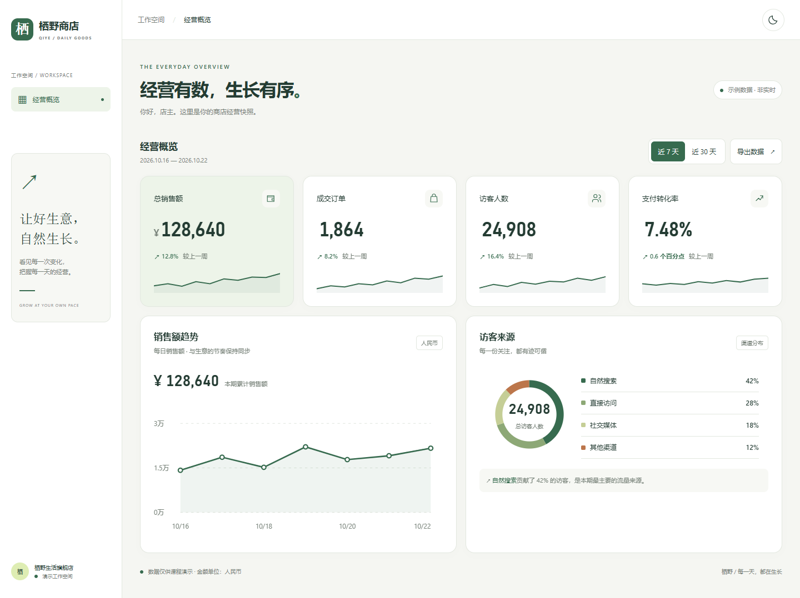
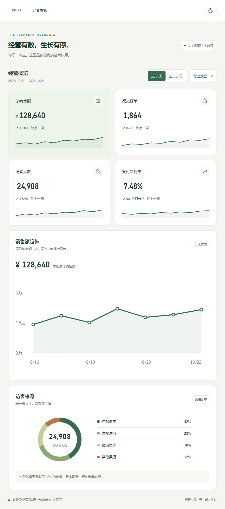
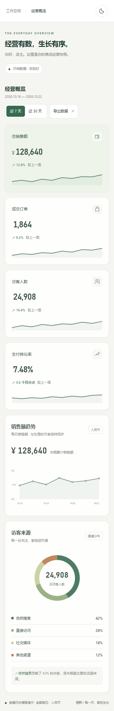
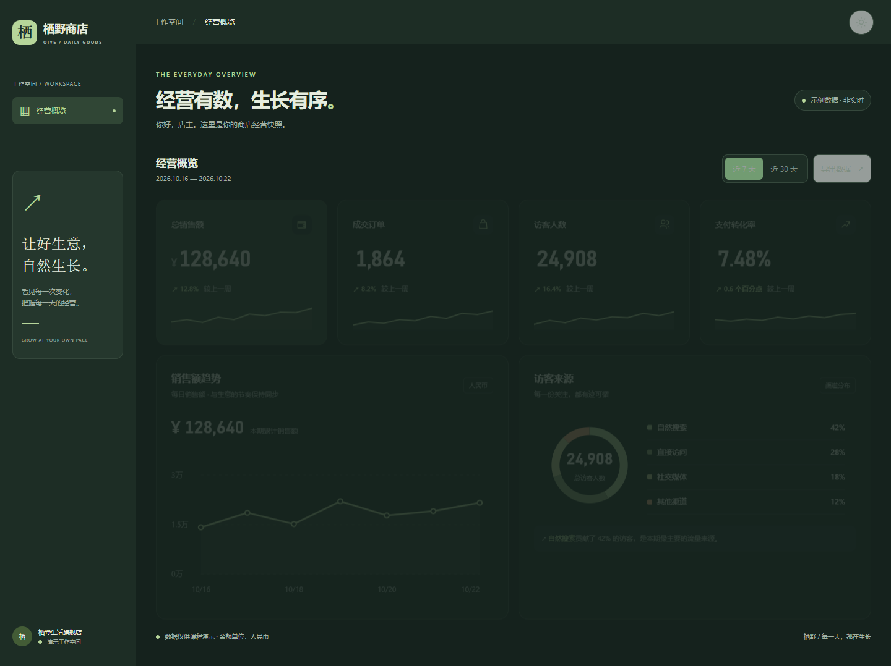

# 栖野商店 · 响应式经营看板

HTML + CSS + 原生 JavaScript 课后作业。所有数字均为示例数据。

## 运行

下载并解压项目，使用现代 Edge、Chrome 或 Firefox 打开 `index.html` 即可。无需安装依赖、联网、登录或启动后端。

## 文件

- `index.html`：语义化页面结构。
- `styles.css`：响应式 Grid 布局、CSS 主题变量。
- `app.js`：六卡数据渲染、周期切换、SVG 图表、主题记忆、CSV 导出。
- `PROMPT.md`：可复现本项目的实现提示词。
- `TESTING.md`：测试范围与结果。
- `screenshots/`：手机、平板、桌面、深色主题效果图。

## 逐项对应作业

|要求|实现|
|---|---|
|三档响应式|小于 768px 单列；768–1199px 两列；1200px 起四列并显示侧栏|
|弹性布局|Grid repeat(auto-fit, minmax(..., 1fr))，CSS 变量按断点计算列宽|
|无横向滚动|minmax(0,1fr)、min-width:0、自适应 SVG、按钮换行；不隐藏横向溢出|
|六卡由 JS 渲染|cards 数组与 periods 数据对象，map 生成六个 section|
|等宽数字|.numeric 使用 font-variant-numeric:tabular-nums|
|CSS 配色与主题|:root 变量与 data-theme，支持浅色/深色及本地记忆|
|图标/图表自适应|SVG viewBox、currentColor、max-width:100%|
|语义标签|h1/h2、section、header、aside、main、button|

四张指标卡下方迷你线为装饰性视觉元素；详细数据请看正式销售额趋势图。近 30 天趋势是区间汇总，图中数值合计等于本期销售额。所有功能均在本地执行。

## 操作

- 点击「近 7 天 / 近 30 天」切换统计数据。
- 点击右上角月亮/太阳按钮切换主题。
- 点击「导出数据」下载当前周期 CSV，含中文编码标记，可由表格软件打开。
- 使用 Tab 键可访问控件；首个链接可跳至正文。

## 公开仓库

按提交者要求，本项目改为提交到 GitHub：[urfhrrfr/qiye-dashboard](https://github.com/urfhrrfr/qiye-dashboard)。点击 Code → Download ZIP 可下载源码，解压后打开 index.html。

## 效果预览

